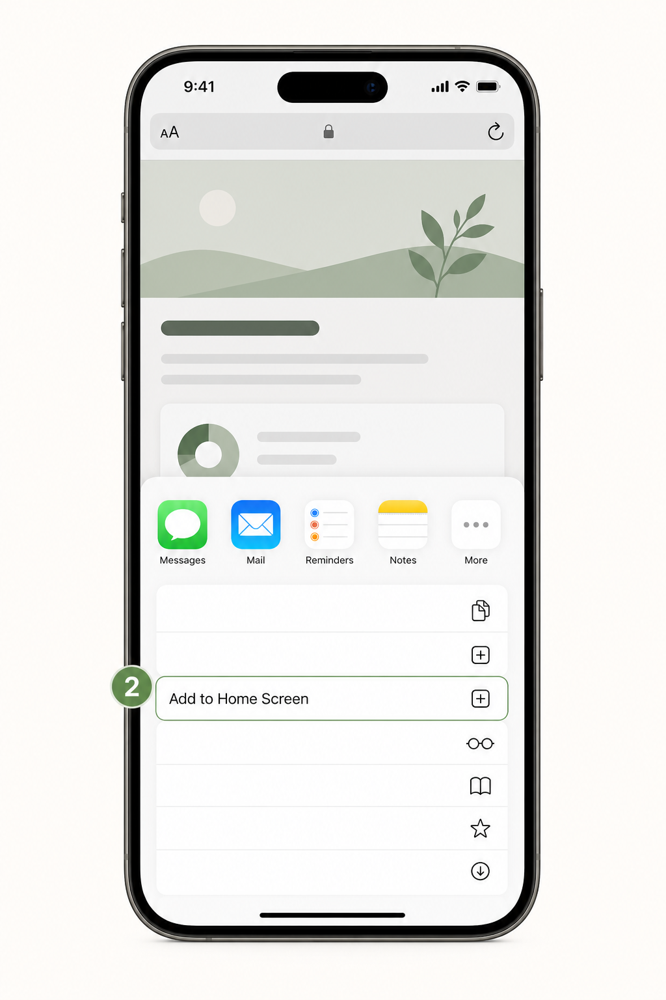
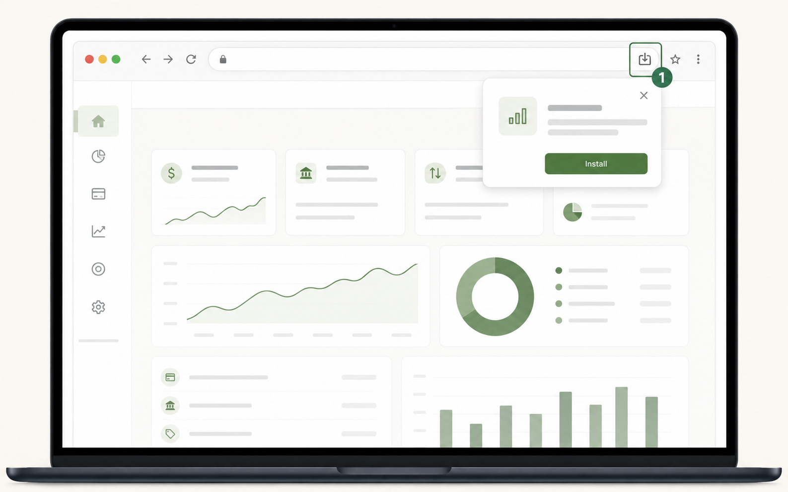

# Install Clarity as an app

Clarity works like an app without an App Store download. Installing it adds an
icon to your home screen (or computer) and opens Clarity in its own focused
window. It takes about a minute.

Open [claritynetworth.com](https://claritynetworth.com) first, then follow the
steps for your device.

## iPhone or iPad

Use **Safari**—the install option is not available from every iPhone browser.

### 1. Tap Share in Safari

The Share button is the square with the upward arrow at the bottom of Safari.

### 2. Choose “Add to Home Screen”

Scroll down the Share Sheet, then tap **Add to Home Screen**.

### 3. Confirm

Keep the name “Clarity” and tap **Add** in the top-right corner. You can now
open Clarity from the new icon on your home screen.

## Android phone or tablet

Use **Chrome** for the smoothest install experience.

### 1. Open Chrome’s menu and choose Install

Tap the three dots in the upper-right corner, then choose **Install app**. On
some Android versions, it is called **Add to Home screen** instead.

### 2. Confirm install

Tap **Install** when Android asks. Clarity will appear in your app drawer and,
depending on your phone, on your home screen too.

## Computer

### 1. Select the install icon

In Chrome or Edge, look for the install icon on the right side of the address
bar. Select it, then choose **Install**.

### 2. Open it like any app

The installed app opens in its own window and can be launched from your
Applications folder or Start menu.

## A few helpful notes

- Installing Clarity does not share your financial data with your device maker
  or browser.
- Your sign-in and connections work the same way in the installed app as they
  do in the browser.
- If you do not see an install option, refresh the page and make sure you are
  on `https://claritynetworth.com`. On iPhone/iPad, use Safari; on Android,
  use Chrome.
- You can remove the icon later just like any other app. This does not delete
  your Clarity account or linked financial data.

Need help? Contact [Clarity support](https://claritynetworth.com/support).
