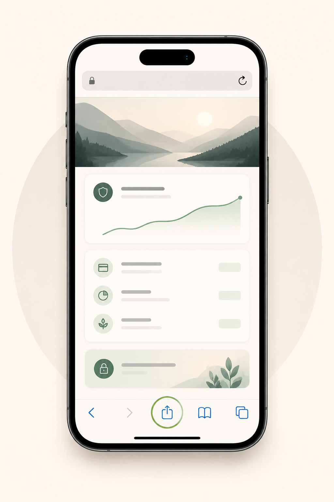
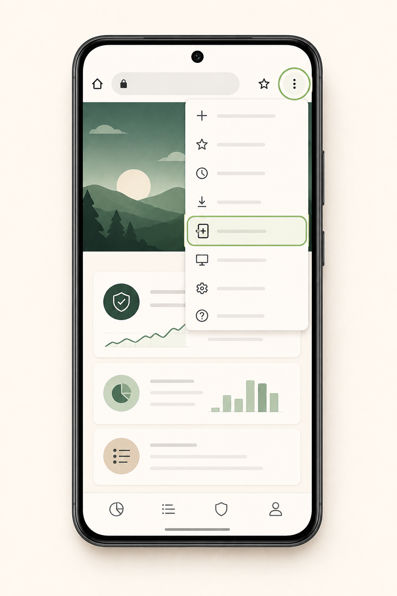

# Install Clarity on your phone

Clarity works like an app without an App Store download. Installing it puts an
icon on your home screen and opens it in its own focused window.

Open [claritynetworth.com](https://claritynetworth.com) first, then follow the
steps for your device.

## iPhone or iPad

Use **Safari**—the install option is not available from every iPhone browser.

1. Open Clarity in Safari.
2. Tap **Share** (the square with the upward arrow) in Safari’s toolbar.
3. Scroll down and tap **Add to Home Screen**.
4. Keep the name “Clarity,” then tap **Add**.
5. Open Clarity from the new icon on your home screen.

## Android phone or tablet

Use **Chrome** for the smoothest install experience.

1. Open Clarity in Chrome.
2. Tap the three-dot menu in the upper-right corner.
3. Tap **Install app** or **Add to Home screen**.
4. Confirm **Install**.
5. Open Clarity from your app drawer or home screen.

## Computer

In Chrome or Edge, open Clarity and look for the install icon in the right side
of the address bar. Select it, then confirm **Install**. The installed app will
open in its own window and can be launched from your Applications or Start menu.

## A few helpful notes

- Installing Clarity does not share your financial data with your device maker
  or browser.
- Your sign-in and connections work the same way in the installed app as they
  do in the browser.
- If you do not see an install option, refresh the page, make sure you are on
  `https://claritynetworth.com`, and try Safari on iPhone/iPad or Chrome on
  Android.
- You can remove the icon later just like any other app. This does not delete
  your Clarity account or linked financial data.

Need help? Contact [Clarity support](https://claritynetworth.com/support).
